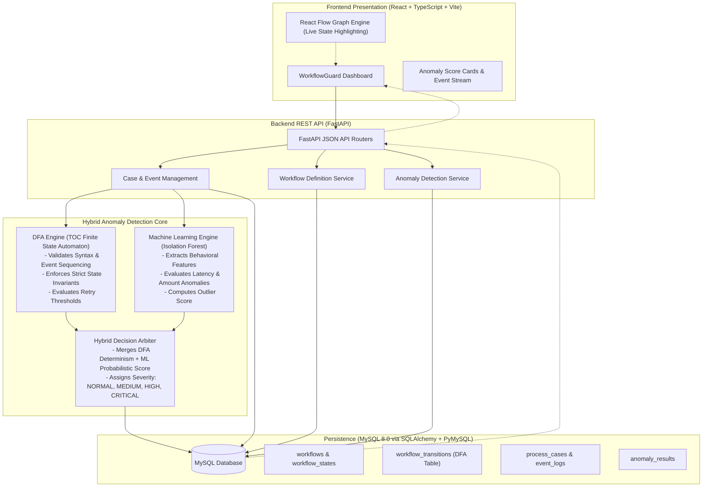

# WorkflowGuard: System Architecture & Technical Specification

## 1. System Overview

**WorkflowGuard** is an anomaly detection system designed for business process workflows. It pairs **Theory of Computation (Automata Theory)** with **Machine Learning (Isolation Forest)** to provide real-time syntactic and behavioral verification of process execution traces.

The initial reference workflow implemented is **Online Payment Processing**.

---

## 2. High-Level Architecture

---

## 3. End-to-End Data Flow

1. **Event Ingestion**:
   - A business event (e.g. `INITIATE_PAYMENT`) is posted to `POST /api/v1/cases/{case_id}/events`.
   - The payload contains event metadata (case ID, current event, execution latency in milliseconds, transaction amount, retry counter).

2. **DFA Verification (Syntactic Check)**:
   - The engine looks up the current state $q_{curr}$ of the case from the database or session.
   - It queries the transition function $\delta(q_{curr}, \text{event})$.
   - If no valid transition is defined or if guard conditions (e.g. `retry_count > 3`) are violated:
     - The state transitions to `TRAP_STATE`.
     - The DFA immediately issues a **SYNTACTIC ANOMALY** flag with reason code (e.g., `ILLEGAL_TRANSITION`, `MAX_RETRIES_EXCEEDED`).

3. **Isolation Forest Evaluation (Behavioral Check)**:
   - A feature vector is extracted: $[ \Delta t_{\text{duration}}, \text{amount}, \text{retry\_count}, \text{step\_index} ]$.
   - The pre-trained or calibrated Isolation Forest assesses tree path lengths and returns:
     - Decision: Normal ($+1$) or Outlier ($-1$).
     - Anomaly score: $s \in [0.0, 1.0]$.

4. **Hybrid Decision Arbiter**:
   - Compares the results according to the hybrid decision matrix:
     - **DFA Failure**: Irrespective of ML score, flagged as **CRITICAL / HIGH** severity anomaly.
     - **DFA Success + ML Normal**: Verified as **NORMAL**.
     - **DFA Success + ML Outlier**: Flagged as **MEDIUM / HIGH** severity behavioral anomaly (e.g., bot-speed sub-millisecond execution, suspicious payment amount deviation).

5. **Persistence & UI Telemetry**:
   - The event is appended to `event_logs`.
   - The case state in `process_cases` is updated.
   - An entry is inserted into `anomaly_results`.
   - Real-time response is returned to the frontend, updating the React Flow diagram node highlights and anomaly log table.

---

## 4. Theory of Computation: Formal Automata Specification

The workflow is modeled as a **Deterministic Finite Automaton (DFA)**:

$$M = (Q, \Sigma, \delta, q_0, F)$$

### 4.1. Set of States ($Q$)
- $q_0 = \text{ORDER\_CREATED}$ (Initial state)
- $q_1 = \text{PAYMENT\_INITIATED}$
- $q_2 = \text{PAYMENT\_VERIFYING}$
- $q_3 = \text{PAYMENT\_FAILED}$
- $q_4 = \text{ORDER\_CONFIRMED}$ (Terminal Accept state)
- $q_5 = \text{ORDER\_CANCELLED}$ (Terminal Reject / Cancellation state)
- $q_{trap} = \text{TRAP\_STATE}$ (Dead-end error state for illegal transitions)

$$Q = \{ q_0, q_1, q_2, q_3, q_4, q_5, q_{trap} \}$$

### 4.2. Alphabet of Events ($\Sigma$)
$$\Sigma = \{ \text{CREATE\_ORDER}, \text{INITIATE\_PAYMENT}, \text{VERIFY\_PAYMENT}, \text{PAYMENT\_SUCCESS}, \text{PAYMENT\_FAILURE}, \text{RETRY\_PAYMENT}, \text{EXCEED\_MAX\_RETRIES}, \text{CANCEL\_ORDER} \}$$

### 4.3. Transition Function ($\delta: Q \times \Sigma \to Q$)

| Current State ($q$) | Input Symbol ($a \in \Sigma$) | Next State ($\delta(q, a)$) | Guard Condition / Rule |
| :--- | :--- | :--- | :--- |
| $\emptyset$ (Start) | `CREATE_ORDER` | `ORDER_CREATED` ($q_0$) | Case initialized |
| `ORDER_CREATED` ($q_0$) | `INITIATE_PAYMENT` | `PAYMENT_INITIATED` ($q_1$) | Valid |
| `ORDER_CREATED` ($q_0$) | `CANCEL_ORDER` | `ORDER_CANCELLED` ($q_5$) | Customer aborts order |
| `PAYMENT_INITIATED` ($q_1$) | `VERIFY_PAYMENT` | `PAYMENT_VERIFYING` ($q_2$) | Gateway verification started |
| `PAYMENT_INITIATED` ($q_1$) | `CANCEL_ORDER` | `ORDER_CANCELLED` ($q_5$) | Session cancelled before verify |
| `PAYMENT_VERIFYING` ($q_2$) | `PAYMENT_SUCCESS` | `ORDER_CONFIRMED` ($q_4$) | Gateway success response |
| `PAYMENT_VERIFYING` ($q_2$) | `PAYMENT_FAILURE` | `PAYMENT_FAILED` ($q_3$) | Gateway failure response |
| `PAYMENT_FAILED` ($q_3$) | `RETRY_PAYMENT` | `PAYMENT_INITIATED` ($q_1$) | Allowed if $\text{retry\_count} < 3$ |
| `PAYMENT_FAILED` ($q_3$) | `EXCEED_MAX_RETRIES`| `ORDER_CANCELLED` ($q_5$) | Triggered when $\text{retry\_count} \ge 3$ |
| `PAYMENT_FAILED` ($q_3$) | `CANCEL_ORDER` | `ORDER_CANCELLED` ($q_5$) | User abandons checkout |
| *Any other pair $(q, a)$* | *Undefined event* | `TRAP_STATE` ($q_{trap}$) | **DFA Violation Detected** |

### 4.4. Terminal States ($F$)
$$F = F_{success} \cup F_{failure} = \{ \text{ORDER\_CONFIRMED}, \text{ORDER\_CANCELLED} \}$$

---

## 5. Machine Learning Specification: Isolation Forest

### 5.1. Objective
Detect timing, rate, and contextual anomalies that follow valid grammar rules but exhibit anomalous execution behavior.

### 5.2. Mathematical Foundation
Isolation Forest exploits two quantitative properties of anomalies:
1. They are few in number.
2. They have attribute values divergent from normal points.

The anomaly score for instance $x$ given a dataset of size $n$ is:

$$s(x, n) = 2^{-\frac{\mathbb{E}(h(x))}{c(n)}}$$

Where:
- $h(x)$ is the path length of point $x$ in an isolation tree.
- $\mathbb{E}(h(x))$ is the expected path length over an ensemble of trees.
- $c(n) = 2 \ln(n - 1) + 0.5772156649 - \frac{2(n - 1)}{n}$ is the average path length of unsuccessful searches in a Binary Search Tree (BST).

### 5.3. Feature Vector
For each incoming event $e_i$:
$$\mathbf{x}_i = [ \Delta t_i, A_i, R_i, H_i ]$$
- $\Delta t_i$: Transition duration in milliseconds (detects sub-human bot speeds $< 50\text{ms}$ or stalled states $> 600,000\text{ms}$).
- $A_i$: Transaction amount (monetary value).
- $R_i$: Current retry counter for the case.
- $H_i$: Hour of execution (temporal distribution).

---

## 6. Hybrid Decision Arbiter

The arbitration engine produces an explainable composite verdict:

| DFA Syntactic Result | ML Behavioral Result | Final Verdict | Severity | Action / Explanation |
| :--- | :--- | :--- | :--- | :--- |
| **VALID** | **NORMAL** | `NORMAL` | `NONE` | Step accepted; process proceeds normally. |
| **VALID** | **OUTLIER** | `BEHAVIORAL_ANOMALY` | `MEDIUM` or `HIGH` | Valid transition, but timing or amount is abnormal (e.g., bot speed or huge amount). Flagged for review. |
| **INVALID** | **NORMAL** | `SYNTACTIC_ANOMALY` | `CRITICAL` | Impossible transition attempted (e.g. skipping verification directly to confirm). Immediate halt. |
| **INVALID** | **OUTLIER** | `COMPOUND_ANOMALY` | `CRITICAL` | Severe protocol breach with abnormal telemetry. Immediate halt & security alert. |

---

## 7. Planned API Endpoints

All endpoints use JSON payloads and are prefixed with `/api/v1`.

### 7.1. Workflow Definitions
- `GET /api/v1/workflows`
  - Returns list of configured workflows.
- `GET /api/v1/workflows/{workflow_id}`
  - Returns workflow metadata, states $Q$, and transition matrix $\delta$.
- `GET /api/v1/workflows/{workflow_id}/graph`
  - Returns React Flow node/edge format for graph canvas rendering.

### 7.2. Process Case Execution & Simulation
- `POST /api/v1/cases`
  - Creates a new case instance (e.g. new checkout session).
  - Request body: `{ "workflow_id": 1, "case_id": "CASE-101", "total_amount": 149.99, "user_id": "usr_42" }`
- `GET /api/v1/cases/{case_id}`
  - Returns current status, current state, retry count, and history.
- `POST /api/v1/cases/{case_id}/events`
  - Emits a process transition event.
  - Request body: `{ "event_name": "INITIATE_PAYMENT", "execution_duration_ms": 1250, "payload": { ... } }`
  - Response body: `{ "case_id": "CASE-101", "current_state": "PAYMENT_INITIATED", "dfa_verdict": { ... }, "ml_verdict": { ... }, "final_verdict": "NORMAL" }`

### 7.3. Anomaly Analytics & Forensics
- `GET /api/v1/cases/{case_id}/anomalies`
  - Returns detected anomalies for a specific case with attribution logs.
- `GET /api/v1/anomalies`
  - Paginated list of all anomalies detected across all workflows.
- `POST /api/v1/simulation/run-batch`
  - Executes batch synthetic traces (normal cases, sequence skip attacks, retry exhaustions, bot timings) to demonstrate detection metrics.
